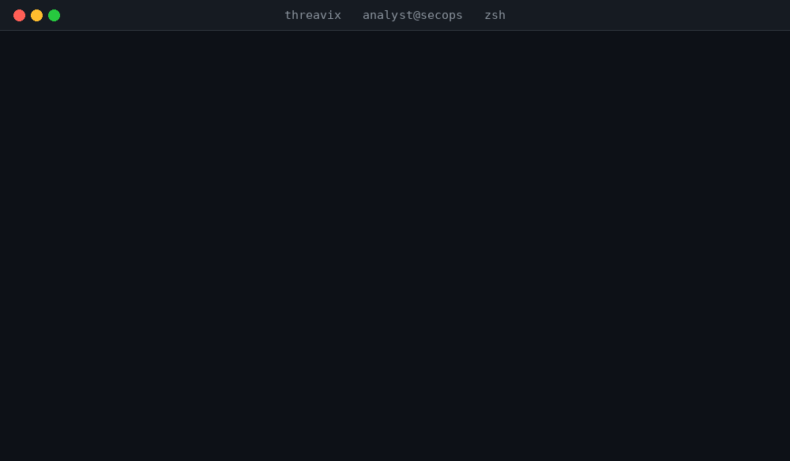
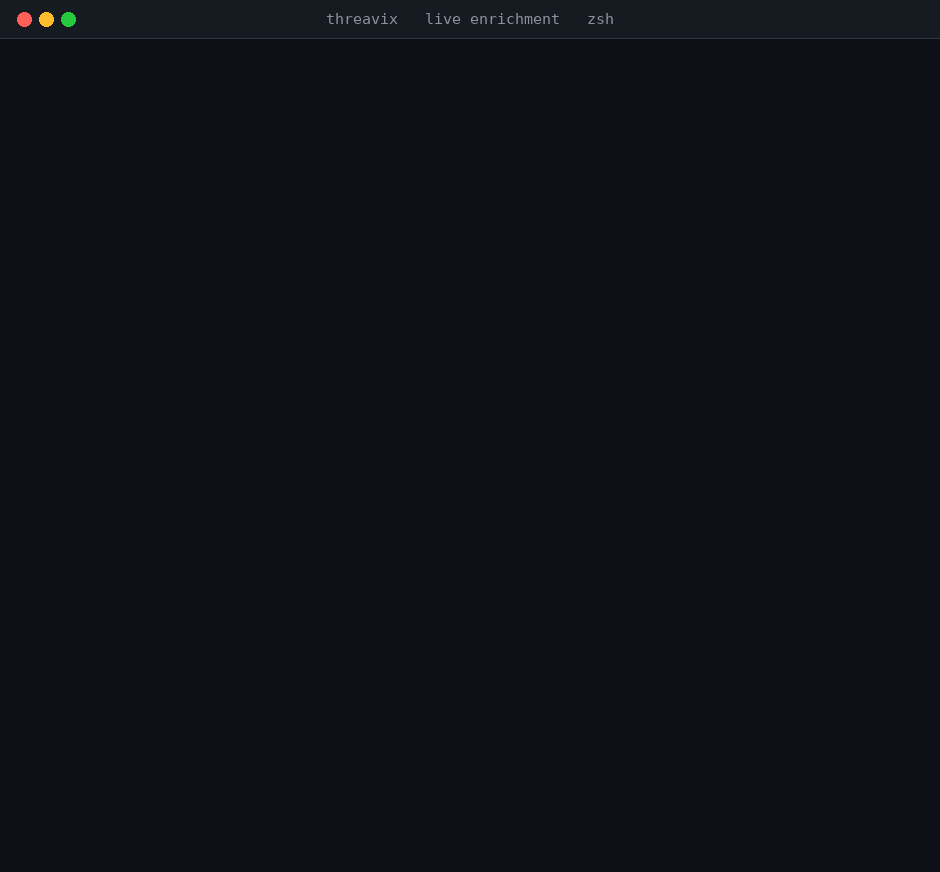
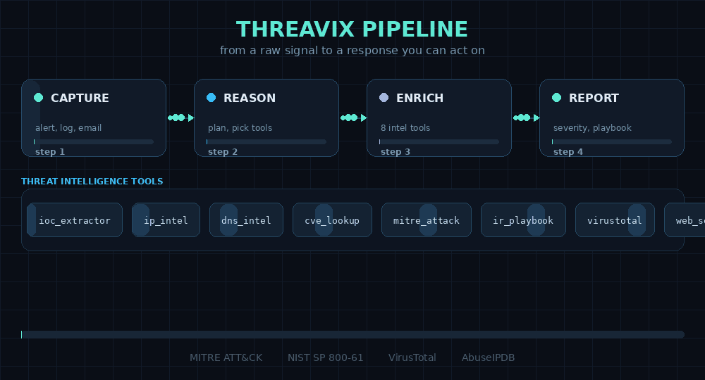
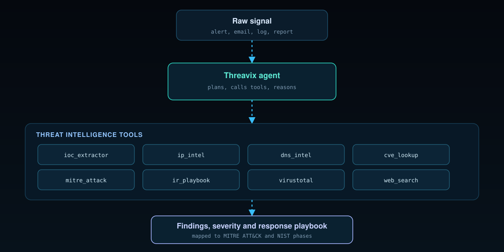
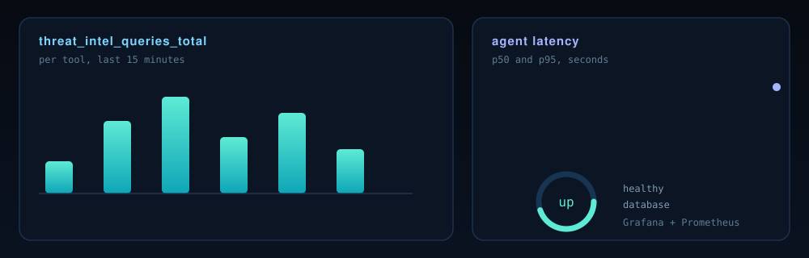

[](https://www.python.org/)
[](LICENSE)
[](#tests)
[](https://fastapi.tiangolo.com/)
[](https://langchain-ai.github.io/langgraph/)
[](Dockerfile)

Threavix is a self hosted AI analyst for security teams. You hand it an alert, an email, or a
single line from a log file. It pulls the indicators out of that text, looks each one up against
real threat intel sources, and gives you back a short report with what to block, what to watch,
and what to do next. It runs as a FastAPI service, does its thinking with LangGraph, and remembers
the people it works with.

Every tool it holds makes a real network call and returns real data. When a source is down, rate
limited, or missing an API key, the tool says so in plain words. It never invents an indicator or
a detection count to fill the gap.

## Why this exists

During an incident I always ended up with the same three browser tabs open. One for reputation,
one for the CVE page, one for my notes. The copy pasting between them cost more time than the
actual analysis. I wanted one place that gathers the evidence first and answers second, so the
person on call can read a single reply and act on it.

Threavix is that place. It keeps the analyst in control: the model proposes, the tools prove, and
the answer shows you where each fact came from.

## What it does

- Reads raw alerts, emails, logs, and analyst notes, then extracts the indicators inside them. It
  understands defanged values too, so `evil[.]com` and `hxxp://` come back as something you can
  actually use.
- Enriches IPs and domains with geolocation, network ownership, and reputation.
- Resolves DNS records, which is often the fastest way to spot a phishing domain that was stood up
  an hour ago.
- Looks up CVEs with their CVSS scores, weakness type, and affected products.
- Maps what an attacker did to MITRE ATT&CK techniques, so you can see the tactics behind a single
  alert.
- Hands back an incident response playbook for the type of incident you are dealing with, written
  around the NIST and SANS phases.
- Searches the open web for the latest reporting on a campaign, actor, or vulnerability.
- Adds multi engine detection data from VirusTotal when you give it a key.

## A quick look

The clip below is a real session. It runs the test suite, then pulls the indicators out of a
sample alert. The output on screen is the actual output from the code in this repo.



## The tools

| Tool | Where the data comes from | Needs a key | What it is for |
|---|---|---|---|
| `ioc_extractor` | Runs locally | No | Pull and clean indicators out of any text |
| `ip_intel` | ipwho.is, plus AbuseIPDB and VirusTotal if configured | No | IP location, network owner, reputation |
| `dns_intel` | The system resolver | No | A, AAAA, CNAME, MX, NS, TXT, and SOA records |
| `cve_lookup` | CIRCL CVE API | No | Vulnerability details, CVSS, affected products |
| `mitre_attack_lookup` | MITRE ATT&CK data on GitHub | No | Find a technique by ID or by keyword |
| `ir_playbook` | Bundled with the app | No | Phase by phase response steps for ten incident types |
| `virustotal_lookup` | VirusTotal | Yes | Multi engine detections and reputation |
| `web_search` | DuckDuckGo | No | Context on campaigns, actors, and fresh CVEs |

The playbooks cover phishing, ransomware, malware, compromised credentials, data exfiltration,
denial of service, web application compromise, insider threat, cloud compromise, and supply chain
issues. They live in `app/core/langgraph/tools/ir_playbook.py` and you can edit them to match how
your own team responds.

### Enrichment you can watch happen

This is another real run. It asks the IP tool about `8.8.8.8` and the DNS tool about `example.com`,
then prints what came back. The values are live lookups, not a fixture.



## How a request flows



A request lands on the chat endpoint. The agent decides which tools it needs and runs them, and
the results come back into the model, which writes the final answer. If one tool fails, the agent
keeps going with what it has. Tools never crash the run.

The same pipeline, drawn out in full:



## Quick start

You need Python 3.13 or newer, uv, and Docker for the database.

1. Copy the example environment file and fill in your values.

   ```bash
   cp .env.example .env.development
   ```

   Set `OPENAI_API_KEY` and `JWT_SECRET_KEY` at a minimum. Every threat intel key is optional.

2. Install the dependencies.

   ```bash
   make install
   ```

3. Start PostgreSQL.

   ```bash
   docker compose --env-file .env.development up -d db
   ```

4. Run the API.

   ```bash
   make dev
   ```

The docs are at `http://127.0.0.1:8000/docs`. The app checks its own health at `/health`.

## Settings

The full list is in `.env.example`. The ones people change most:

| Setting | What it does | Default |
|---|---|---|
| `OPENAI_API_KEY` | The LLM provider key | not set |
| `DEFAULT_LLM_MODEL` | The main model, with automatic fallback to the others | `gpt-5-mini` |
| `JWT_SECRET_KEY` | Signs the access tokens | not set |
| `POSTGRES_HOST` `POSTGRES_PORT` `POSTGRES_DB` `POSTGRES_USER` `POSTGRES_PASSWORD` | Database connection | `threavix` |
| `VIRUSTOTAL_API_KEY` | Turns on VirusTotal enrichment | not set |
| `ABUSEIPDB_API_KEY` | Turns on AbuseIPDB enrichment | not set |
| `LANGFUSE_PUBLIC_KEY` `LANGFUSE_SECRET_KEY` | Tracing and evaluation | not set |
| `THREAT_INTEL_TIMEOUT` | Seconds to wait on an outbound lookup | `15` |

## Using it

Every chat call needs a session token in the `Authorization` header. Register a user, then open a
session.

```bash
# create your account
curl -X POST http://127.0.0.1:8000/api/v1/auth/register \
  -H 'Content-Type: application/json' \
  -d '{"email":"analyst@example.com","password":"Threavix!2026"}'

# open a session (use the user token from the step above)
curl -X POST http://127.0.0.1:8000/api/v1/auth/session \
  -H "Authorization: Bearer <USER_TOKEN>"
```

Now ask it to triage something.

```bash
curl -X POST http://127.0.0.1:8000/api/v1/chatbot/chat \
  -H "Authorization: Bearer <SESSION_TOKEN>" \
  -H 'Content-Type: application/json' \
  -d '{
    "messages": [
      {"role": "user", "content": "Triage this alert. An inbound email carried the link hxxp://secure-login[.]example/verify and came from 203.0.113.9. Pull the indicators, enrich them, and give me a response plan."}
    ]
  }'
```

The reply follows one shape: a short summary with a confidence level, the indicators it used, what
each tool returned with the source named, an assessment tied to ATT&CK where it fits, then the
recommended actions split by detect, contain, eradicate, and recover, and finally the next pivots
worth running.

An illustrative reply, using the reserved documentation IP range:

```
Summary: Likely credential phishing. Confidence medium.

Indicators:
  url      http://secure-login.example/verify   (shared as hxxp://secure-login[.]example/verify)
  ipv4     203.0.113.9

Findings:
  ip_intel   country, ASN and network owner from ipwho.is; no proxy or VPN flag returned
  dns_intel  domain has an A record but no MX record, which is unusual for a login page
  web_search no public reporting matched this domain yet

Assessment:
  The lure matches T1566 Phishing and T1204 User Execution. A brand new domain with no mail
  records and a login page is a common credential harvesting pattern. Single source, so treat
  attribution as unknown.

Recommended actions:
  Detect    search mail logs for every recipient of the message and any clickthrough
  Contain   block the domain and IP at the mail gateway, proxy, and DNS, quarantine the message
  Eradicate remove any delivered message, reset credentials for anyone who submitted them
  Recover   re enroll MFA for affected accounts and watch sign ins for a few days

Next steps:
  check proxy logs for any POST to that domain, and check identity logs for impossible travel.
```

### Endpoints

| Method | Path | Purpose |
|---|---|---|
| `POST` | `/api/v1/auth/register` | Create a user |
| `POST` | `/api/v1/auth/login` | Get a user token |
| `POST` | `/api/v1/auth/session` | Open a chat session |
| `GET` | `/api/v1/auth/sessions` | List your sessions |
| `POST` | `/api/v1/chatbot/chat` | Send messages and get a reply |
| `POST` | `/api/v1/chatbot/chat/stream` | Same, streamed as server sent events |
| `GET` | `/api/v1/chatbot/messages` | Read a session history |
| `DELETE` | `/api/v1/chatbot/messages` | Clear a session history |
| `GET` | `/health` | Health of the API and the database |
| `GET` | `/metrics` | Prometheus metrics |

## Scoring the answers

There is an LLM as a judge suite that grades real traces from Langfuse. The metrics were rewritten
for this domain, because a made up hash is far worse here than a slightly long sentence.

| Metric | What it catches |
|---|---|
| Hallucination | Invented indicators, CVEs, attribution, or tool output |
| IOC accuracy | Indicators that were altered, mistyped, or never present to begin with |
| Helpfulness | Answers that sound fine but give no usable action |
| Relevancy | Replies that drift away from the incident |
| Conciseness | Padding that buries the important line |
| Toxicity | Unprofessional language, even about the attackers |

Run it after a few live chat calls:

```bash
make eval-quick
```

The prompts sit in `evals/metrics/prompts/`. Drop a new markdown file there and it becomes a new
metric.

## Watching it run



- Langfuse traces every run, step by step, with tokens and latency.
- Prometheus scrapes `/metrics`. Alongside the usual HTTP timings there is
  `threat_intel_queries_total`, labelled by tool, so you can see which lookups your analysts lean on.
- Grafana comes with a latency dashboard at `http://localhost:3000`. The default login is
  `admin` and `admin`.
- Logs are structured. JSON in staging and production, a readable console format in development.

## Tests

```bash
uv run pytest -q
```

The suite runs without a network connection and without any API keys. It checks indicator
extraction on defanged input, hash length handling, private address detection, playbook selection,
and CVE report formatting for both the current CVE 5.0 records and the older flat records.

## Running the whole stack in Docker

```bash
make docker-compose-up ENV=development
```

That brings up the API, PostgreSQL with pgvector, Prometheus, Grafana, and cAdvisor. To stop it:

```bash
make docker-compose-down ENV=development
```

## Layout

```
app/
  api/v1/            auth and chat endpoints
  core/
    config.py        settings loaded from the environment
    langgraph/
      graph.py       the agent workflow
      tools/         the threat intelligence tools
    prompts/
      system.md      the analyst instructions
  services/          database and LLM services
  utils/
    threat_intel.py  indicator extraction and refanging
evals/               the judging suite
docs/assets/         the images in this file
tests/               offline tests
```

## A note on safety

Threavix is built for defense. It will not help with intrusion, malware writing, or hiding from
detection on systems you do not own or protect.

The lookups send indicators to third parties. The keyless sources are ipwho.is, cve.circl.lu, the
MITRE ATT&CK data on GitHub, and DuckDuckGo. If you also set the premium keys, those indicators go
to VirusTotal and AbuseIPDB as well. Keep that in mind before you paste in anything you are not
allowed to share.

Never commit your `.env` files. The `.gitignore` and `.dockerignore` already keep them out.

## License

MIT. See [LICENSE](LICENSE).
